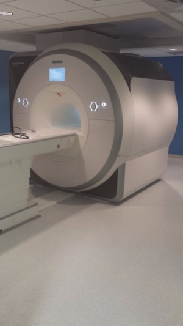

[Home](/ "Home") >

# History of the Dartmouth Brain Imaging Center (DBIC)

In November of 1999, Dartmouth College became the first liberal arts school in the country to own and operate an MRI machine for strictly research purposes.

The DBIC first opened under the direction of Scott Grafton with a 1.5T GE MRI machine. DBIC upgraded to a 3.0T Philips MRI machine in 2004. In August 2016, DBIC upgraded to its current Siemens 3T PRISMA  scanner. Professor George Wolford served as the interim director in 2006 and 2007. [Jim Haxby](https://pbs.dartmouth.edu/people/james-v-haxby) joined Dartmouth in January 2008, and served as the director of the DBIC until June 2021. In July of 2021, the DBIC was pleased to welcome [Tor Wager](https://pbs.dartmouth.edu/people/tor-wager) as the new director.

