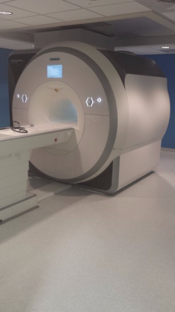

[Home](/ "Home") >

# History of the Dartmouth Brain Imaging Center (DBIC)

In November of 1999, Dartmouth College became the first liberal arts school in the country to own and operate an MRI machine strictly for research.



