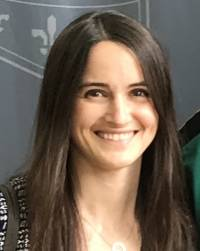

[Home](../index.md "Home") >
 [People](index.md) >

# DBIC Advisory Committee

<table border="0">
<tbody>
<tr>
<td></td>
<td>

<a href="http://pbs.dartmouth.edu/people/luke-j-chang-0" title="Luke Chang faculty page">Luke J. Chang</a>

Associate Professor of Psychological and Brain Sciences

</td>
</tr>
<tr>
<td></td>
<td>

<a href="https://pbs.dartmouth.edu/people/emily-s-finn">Emily S. Finn</a>

Assistant Professor

</td>
</tr>
<tr>
<td></td>
<td>

<a href="https://pbs.dartmouth.edu/people/yaroslav-o-halchenko-0">Yaroslav Halchenko</a>

Research Professor of Psychological and Brain Sciences; Adjunct Associate Professor of Computer Science

</td>
</tr>
<tr>
<td></td>
<td>

<a href="http://pbs.dartmouth.edu/people/james-v-haxby" title="James Haxby faculty page">James V. Haxby</a>

Professor

</td>
</tr>
<tr>
<td> </td>
<td>

<a href="https://pbs.dartmouth.edu/people/caroline-robertson" title="Robertson Lab">Caroline Robertson</a>

Associate Professor of Psychological and Brain Sciences

</td>
</tr>
<tr>
<td> </td>
<td>

<a href="https://pbs.dartmouth.edu/people/courtney-rogers">Courtney Rogers</a>

Associate Director for Operations

The Dartmouth Brain Imaging Center and the Center for Cognitive Neuroscience

</td>
</tr>
<tr>
<td> </td>
<td>

<a href="https://pbs.dartmouth.edu/people/tor-wager" title="Tor Wager">Tor Wager</a>

Director, Dartmouth Brain Imaging Center; Diana L. Taylor Distinguished Professor

</td>
</tr>
</tbody>
</table>
