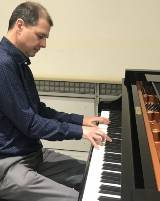
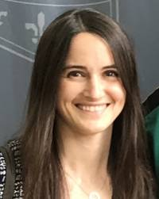
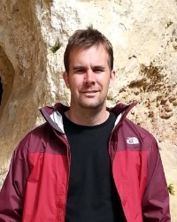
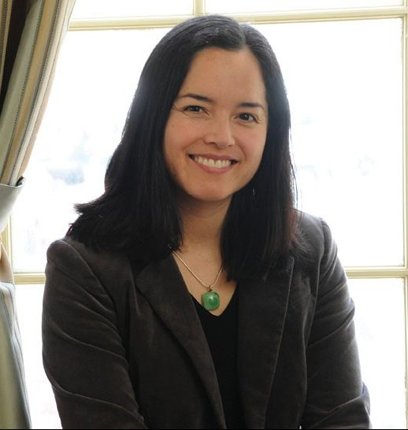
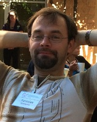
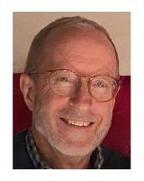
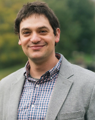
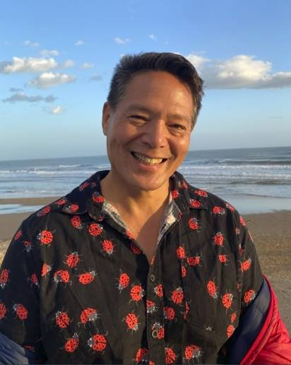
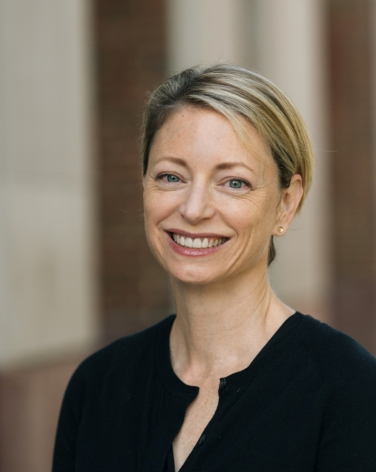

[Home](../index.md "Home") >
 [People](index.md) >

# Affiliated Faculty

The DBIC scanner is utilized by an interdisciplinary community of scientists and scholars who are engaged in neuroscience research at Dartmouth.

<table border="0" class="noborder left">
<tbody>
<tr>
<td></td>
<td>

<a href="https://faculty-directory.dartmouth.edu/michael-casey">Michael Casey</a>

Francis and Mildred Sears Professor

Professor of Computer Science

Professor of Music

 

</td>
</tr>
<tr>
<td> </td>
<td>

<a href="https://pbs.dartmouth.edu/people/emily-s-finn">Emily Finn</a>

Assistant Professor

Department of Psychological and Brain Sciences

</td>
</tr>
<tr>
<td> </td>
<td>

<a href="http://pbs.dartmouth.edu/people/luke-j-chang-0" title="Chang faculty page">Luke J. Chang</a>

Associate Professor of Psychological and Brain Sciences

Department of Psychological and Brain Sciences

</td>
</tr>
<tr>
<td> </td>
<td>

<a href="http://pbs.dartmouth.edu/people/brad-duchaine" title="Duchaine faculty page">Brad Duchaine</a>

Professor of Psychological and Brain Sciences

Department of Psychological and Brain Sciences

</td>
</tr>
<tr>
<td> </td>
<td>

<a href="https://geiselmed.dartmouth.edu/faculty/facultydb/view.php?uid=4330" title="Gilbert-Diamond faculty page">Diane Gilbert-Diamond</a>

Associate Professor of Epidemiology

Geisel School of Medicine at Dartmouth

</td>
</tr>
<tr>
<td> </td>
<td> </td>
</tr>
<tr>
<td>

 

</td>
<td>

<a href="http://pbs.dartmouth.edu/people/richard-h-granger-jr" title="Granger faculty page">Richard H. Granger</a>

Professor

Department of Psychological and Brain Sciences

 

 

<a href="https://pbs.dartmouth.edu/people/yaroslav-o-halchenko-0">Yaroslav Halchenko</a>

Research Professor of Psychological and Brain Sciences Adjunct Associate Professor of Computer Science

Department of Psychological and Brain Sciences

</td>
</tr>
<tr>
<td> </td>
<td>

<a href="http://pbs.dartmouth.edu/people/james-v-haxby" title="Haxby faculty page">James V. Haxby</a>

Professor

Department of Psychological and Brain Sciences

 

</td>
</tr>
<tr>
<td> </td>
<td>

<a href="http://pbs.dartmouth.edu/people/david-kraemer" title="Kraemer faculty page">David Kraemer</a>

Chair, Cognitive Science Program; Associate Professor of Psychological and Brain Sciences

Department of Psychological and Brain Sciences

</td>
</tr>
<tr>
<td> </td>
<td>

<a href="http://pbs.dartmouth.edu/people/jeremy-rothman-manning" title="Manning faculty page">Jeremy Rothman Manning</a>

Associate Professor of Psychological and Brain Sciences

Department of Psychological and Brain Sciences

</td>
</tr>
<tr>
<td> </td>
<td>

 

</td>
</tr>
<tr>
<td></td>
<td>

<a href="https://pbs.dartmouth.edu/people/caroline-robertson" title="Caroline Robertson">Caroline Robertson</a>

Associate Professor of Psychological and Brain Sciences

Department of Psychological and Brain Sciences

</td>
</tr>
<tr>
<td>

 

</td>
<td>

<a href="http://pbs.dartmouth.edu/people/alireza-soltani" title="Soltani faculty page">Alireza Soltani</a>

Associate Professor and Director of Graduate Studies

Department of Psychological and Brain Sciences

 

 

<a href="https://pbs.dartmouth.edu/people/viola-s-stoermer">Viola S. Stoermer</a>

Assistant Professor

Department of Psychological and Brain Sciences

 

<a href="https://pbs.dartmouth.edu/people/arjen-stolk">Arjen Stolk</a>

Assistant Professor

Department of Psychological and Brain Sciences

 

 

<a href="https://pbs.dartmouth.edu/people/mark-thornton">Mark Thornton</a>

Assistant Professor

Department of Psychological and Brain Sciences

</td>
</tr>
<tr>
<td> </td>
<td>

<a href="http://pbs.dartmouth.edu/people/peter-ulric-tse" title="Tse faculty page">Peter Ulric Tse</a>

Chair, Department of Psychological and Brain Sciences

Professor of Psychological and Brain Sciences

Department of Psychological and Brain Sciences

</td>
</tr>
<tr>
<td></td>
<td>

<a href="https://pbs.dartmouth.edu/people/tor-wager" title="Tor Wager">Tor Wager</a>

Director, Dartmouth Brain Imaging Center

Director, Center for Cognitive Neuroscience

Diana L. Taylor Distinguished Professor

Department of Psychological and Brain Sciences

</td>
</tr>
<tr>
<td> </td>
<td>

<a href="http://pbs.dartmouth.edu/people/thalia-wheatley" title="Wheatley faculty page">Thalia Wheatley</a>

Lincoln Filene Professor in Human Relations

Director, Consortium for Interacting Minds

Department of Psychological and Brain Sciences

</td>
</tr>
</tbody>
</table>
