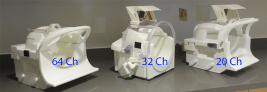

[Research Infrastructure](index.md) >

# Head coils

The DBIC owns three phase array head coils (64, 32 and 20 coil elements).

- The 20-channel head coil is not recommended due to comparatively old technology (in particular, lack of small receiver coils that would improve compatibility with multiband), though it may be the only model able to scan certain subjects with significantly larger heads.
- The 32-channel head coil is an iPAT compatible "no-tune" receiver coil which is capable of parallel imaging and simultaneous multislice acquisition.
- The 64- channel head coil has 64 integrated pre-amplifiers, which benefit from TIM 4G coil technology, ensuring the highest SNR and extreme iPAT / sma performance. Forty out of 64 channels are in the head region while the rest is in the neck region

