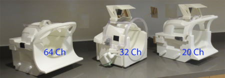

[Research Infrastructure](index.md) >

# Head coils

The DBIC owns three phased-array head coils (64, 32 and 20 channels). Which one suits a study depends on what you need to measure and on who you scan.

## Choosing a coil

The 64-channel head coil is the expected default choice: it is the newest design, has higher signal-to-noise ratio (SNR) in the cortex, and generally fits well, with some constraints. The 32-channel head coil has a more uniform SNR across the brain and a different fit. The 20-channel head coil is the roomiest, but the least advanced, particularly for modern parallel imaging.

Two recommendations for any study:

- Explore at the start of the study which head coil meets your needs.
- Use only one head coil throughout a study, for consistency.

## The three coils

| Coil | Signal-to-noise and imaging performance | Fit |
|---|---|---|
| **64-channel**: the newest design, with 64 integrated preamplifiers. 40 of its 64 channels cover the head and the other 24 the neck. | Higher SNR in the cortex: the small elements are much more sensitive close to the coil, so the SNR profile is weighted towards the cortex, more than with the other coils. The advantage does not reach deep structures, which may be imaged no better than with the 32-channel coil (it depends on the study). Suited to parallel imaging and simultaneous multislice (SMS). | Generally good, and suits a wider range of participants than the 32-channel coil, including those who wear MR-compatible glasses. One particular fit constraint is in the neck. |
| **32-channel**: an earlier design with 32 integrated preamplifiers. | A more uniform SNR across the brain, including deep structures. Suited to parallel imaging and simultaneous multislice (SMS). | Tighter overall: participants with larger heads may not fit comfortably. Its fit constraints differ from the 64-channel coil's. |
| **20-channel**: the oldest design. | The least advanced of the three, particularly for modern parallel imaging: it lacks the small receiver elements that improve compatibility with multiband imaging. | The roomiest. It may be the only coil able to scan some participants with significantly larger heads. |

