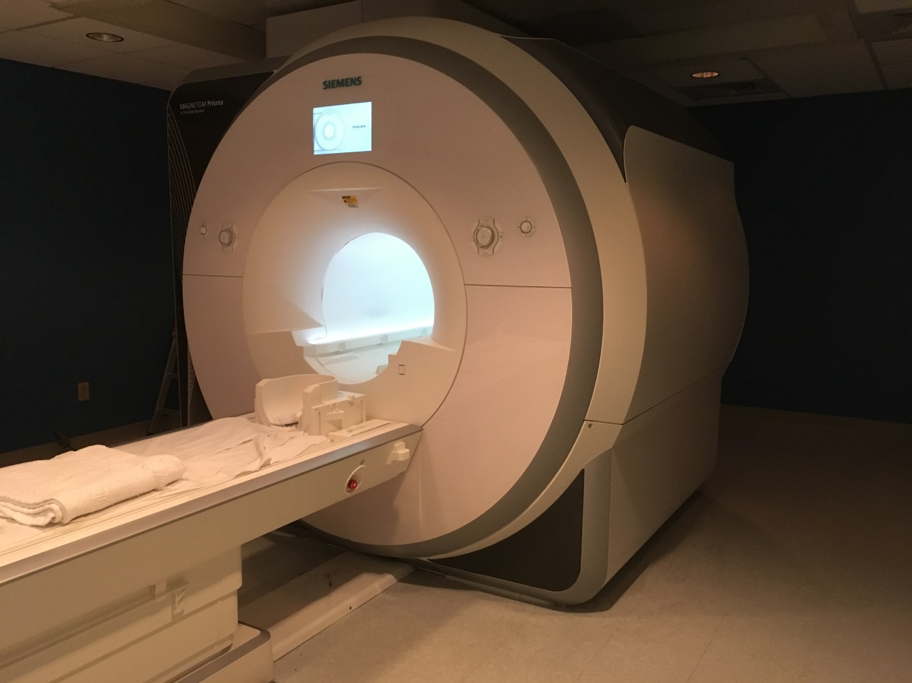

[Research Infrastructure](index.md) >

# fMRI Scanner

Our center is equipped with a state-of-the-art 3.0 Tesla Siemens MAGNETOM Prisma whole-body MRI system (Siemens Medical Solutions, Erlangen, Germany) and a variety of [peripherals](peripherals.md) needed for functional neuroimaging. The scanner operates on the  Siemens XA60 software platform. Vendor supplied packages are available for BOLD (Inline BOLD imaging, 3D PACE syngo and BOLD 3D Evaluation syngo), Diffusion (Diffusion Tensor Imaging, DTI Evaluation and DTI tractography syngo), and Spectroscopy sequences. Advanced hardware integration in our system (e.g. homogeneous 3T magnet,  XR 80/200 gradient system and transmission system) provide excellent B1 homogeneity, and enable novel capabilities such as simultaneous multislice acquisition (sma). Tim 4G  (the Siemens integrated coil system) enables high image quality, faster acquisition and exam time, and higher SNR. On our system, the gradient rise time in all three axes is 200 T/m/s and peak gradient strength is 80 mT/m. Such a  fast and powerful gradient system provides high-speed structural and functional imaging. Along with its uniform 3 tesla (T) magnet,  and capability of first and second order shimming, we are able to facilitate desirable MR spectroscopy, as well as high quality images. The scanner's magnet delivers excellent magnetic homogeneity of 0.25 ppm, as measured within a 40 cm diameter spherical volume (DSV) in the 60 cm bore.
