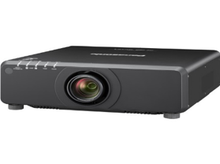
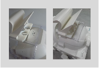
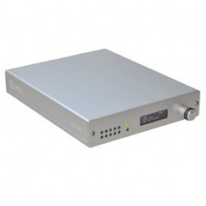
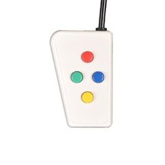
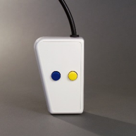
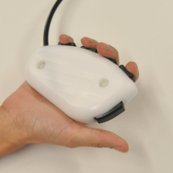
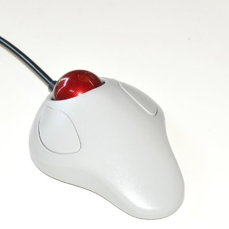
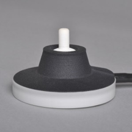
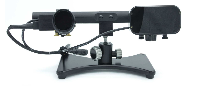

[Research Infrastructure](index.md) >

# Peripheral equipment

General questions, requests for training, or technical support for any
equipment listed here should be directed to: Michael Pearl
([michael.a.pearl@dartmouth.edu](mailto:michael.a.pearl@dartmouth.edu?subject=DBIC%20peripherals)).

## Menu

- [Visual stimulation](#visstim)
- [Auditory stimulation](#audiostim)
- [Participant response devices](#responsedevices)
- [Eye tracking](#eyetracking)
- [Physiological monitoring](#physio)
- [ReproStim](#reprostim)

## Visual stimulation

### Panasonic PT-DW750BU projector

The DBIC uses the Panasonic PT-DW750BU 7000-Lumen WXGA DLP Projector for the presentation of visual stimulus. This projector offers 7000 lumens of brightness and a 3000:1 dynamic contrast ratio, which work together to overcome light in most rooms and provide detail in dark areas of the image. Additionally, this projector has a WXGA 1280 x 800 native resolution for viewing detailed pictures or data. It is powered by a DLP chip system with a dual-lamp design. The PT-DW750BU includes a lens with a 1.8 to 2.5:1 throw ratio that can produce images from 50 to 600".

The projector has HDMI, DVI-D, 5-BNC, and VGA inputs, which allows for different types of external video sources. It is controllable via Ethernet, RS-232, M3, or the included IR/wired remote control.

The projector attaches to stimulus computer via video adapter. The image is mirrored on a monitor in the control room.

- [Panasonic website](https://business.panasonic.co.uk/visual-system/pt-dw750/index.md)
- [DBIC user guide - projector](../assets/dbic/docs/userguides/sop_projector_09132023.pdf)

#### Standing (out of bore) projection information

**Distances**

- eye to mirror - 127mm
- mirror to screen - 1160mm
- screen to projector - 2032mm

#### **Image projection on the standing (out of bore) screen**

- width- 428mm
- height - 266mm
- diagonal - 504mm

#### Eyetracking (in-bore) projection information

#### Distances

- eye to mirror - 127mm
- mirror to screen - 1010mm
- screen to projector - 2182mm

#### Image project on the in-bore screen

- width- 475mm
- height - 297mm
- diagonal - 560mm

**Special note: If you are using the eyetracker (in-bore) screen, please reference the [DBIC projector user guide](../assets/dbic/docs/userguides/sop_projector.pdf) to change the focus of the projector.**

### MRIFocus (MRI-compatible corrective lenses)

The DBIC uses Cambridge Research Systems [MRIFocus for Siemens](https://www.crsltd.com/tools-for-functional-imaging/vision-correction/mrifocus/) corrective lenses for both the 32- and 64-channel head coils.

- [MRIFocus Kit Manufacturer's Users Manual](../assets/dbic/docs/userguides/mrifocus_manufacturer_userguide.pdf)
- [DBIC userguide - MRIFocus kit](../assets/dbic/docs/userguides/userguide_mrifocus.pdf)

## Auditory stimulation

### Audio stimulus (Sensimetrics Model S14)

The S14 insert earphones provide high-quality acoustic stimulus delivery while attenuating scanner noise. They are small enough to fit within any head coil, and can be covered with circumaural muffs for added protection if the coil allows.

Frequency response equalization is achieved by pre-filtering stored digital stimuli. Equalization filters are provided and can be used either within Matlab or with a stand-alone filtering program (provided). A small power amplifier is required.

Audio stimulus is connected to stimulus computer via 2.5mm jack. External speakers are available in the control room to allow monitoring of the audio stimulus.

- [Sensimetric Model S14 website](https://www.sens.com/products/model-s14/)
- [DBIC userguide - Sensimetrics Model S14](../assets/dbic/docs/userguides/sop_sensimetrics_9142023.pdf)

## Participant response devices

### Current Designs 932 interface

The opto-electronic interface receives optical signals from the handheld devices in the MR suite and converts them into electronic signals for the computer.  The [932](https://www.curdes.com/fiu-932b.html) is standards-based: the outputs are not designed to be used with a specific program or hardware platform, but are instead designed to work with everything. This interface provides complete USB, Serial, and Parallel outputs.

- [Current Designs website](https://www.curdes.com/mainforp/interfaces/fiu-932b.html)
- [DBIC user guide - Current Designs 932](../assets/dbic/docs/userguides/sop_curdes_9132023.pdf)

### 4-button bimanual

### 2x2

### Pyka 5-button grip

### Trackball 2

### Joystick

### Optoacoustics FOMRI III microphone

For recording verbal responses from participants during fMRI scanning, the DBIC offers the [Optoacoustics FOMRI III microphone.](https://www.optoacoustics.com/medical/fomri-iii/features)

- [Optoacoustics website](https://www.optoacoustics.com/medical/fomri-iii/features)
- [DBIC Optoacoustics user guide](../assets/dbic/docs/userguides/sop_optoacoustics_09142023.pdf)

## Eye tracking

### SR Research EyeLink 1000 Plus

The DBIC uses the [SR Research Eyelink 1000 Plus](https://www.sr-research.com/fmri-meg-systems/) for eyetracking data collection. Our system offers a high-speed camera with upgraded high-speed tracking, a fiber-optic camera head, long range mounting bar, 890nm Illuminator, 20/32/64 channel Siemens head coil mirror (16cm x 12cm), 50mm lens for MRI, and a Siemens Prisma tray mount.

- [Installation guide for the EyeLink Developers Kit - macOS](../assets/dbic/docs/userguides/installationguide_eyelink_developerskit_macos.pdf)
- [Installation guide for the EyeLink Developers Kit - Windows](../assets/dbic/docs/userguides/installationguide_eyelink_developerskit_windows.pdf)
- [Eyelink user guide](../assets/dbic/docs/userguides/sop_eyelink_09142023.pdf)

## Physiological monitoring

### BIOPAC MP160

For collecting real-time physiological data during fMRI scanning, such as skin conductance, pulse rate, and respiration rate, DBIC maintains a [BIOPAC MP160](https://www.biopac.com/product/mp150-data-acquisition-systems/) system. The system includes a dedicated MacBook laptop running AcqKnowledge software facilitating data recording. A USB interface allows the investigator to connect their laptop to the BIOPAC system for synchronizing experimental and physiological time-courses, or for sending event markers or arbitrary time-course data. The BIOPAC system is highly modular, modifiable, and flexible -- affording investigators a wide range of options for collecting auxiliary data and enhancing experimental protocols.

[BIOPAC user guide](../assets/dbic/docs/userguides/biopac_userguide_091323.pdf)

## ReproStim

ReproStim is a video capture and recording suite for neuroimaging and psychology experiments currently under development at the DBIC and developed by Yarick Halchenko and Andy Connolly. Its goal is to provide experimenters with a complete record of audio and visual stimulation for every data collection session by making it possible to easily collect high fidelity copies of the actual stimuli shown to each subject in the form of video files that can be stored alongside behavioral or neuroimaging data in public repositories.

ReproStim provides for enhanced experimental reproducibility and a safeguard against data loss in cases of data-collection irregularites. Because ReproStim provides an exact record of the actual stimuli delivered during any given experimental session, it makes it possible to precisely reproduce experimental sessions, even if the original trial sets were randomized and precise trial details not recorded. In cases of experimental irregularities, such as aborted fMRI runs, unexpected glitches in trial timing, or programming errors that cause records of trial conditions to be lost, valuable data (which can be especially costly in cases of fMRI of ECog, for example) can be recoded and recovered using the audio-visual record provided by ReproStim.

The developmental version of ReproStim is currently deployed at the DBIC and we are archiving videos of all scanning sessions. The computer called ReproIner runs the ReproStim software at the DBIC. For more information, contact [Yaroslav Halchenko](mailto:yaroslav.o.halchenko@dartmouth.edu?subject=ReproStim) or check out [ReproStim on GitHub](https://github.com/ReproNim/reprostim)
