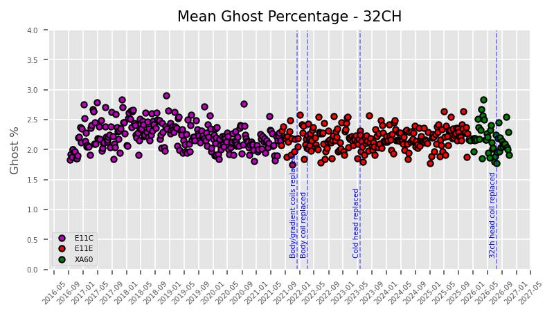
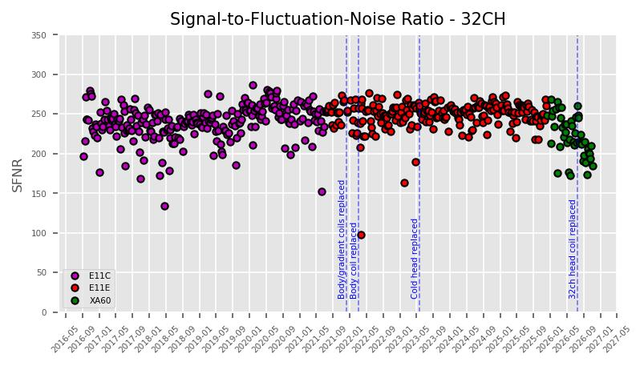
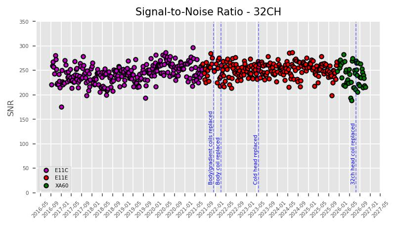
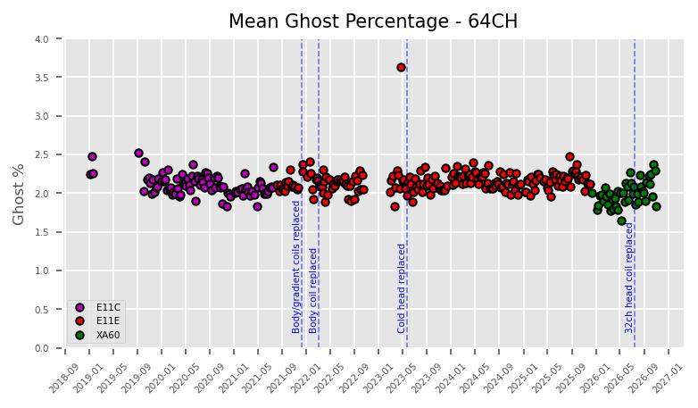
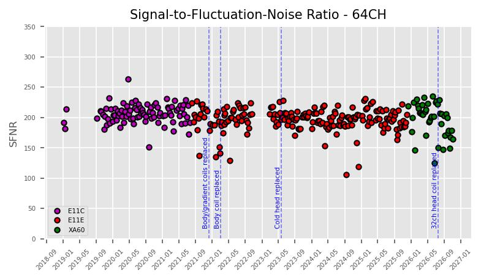
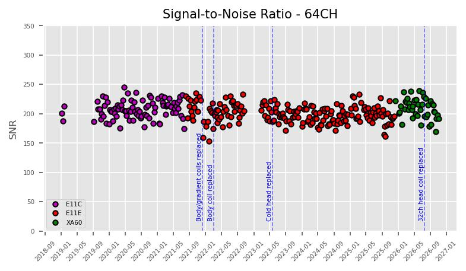
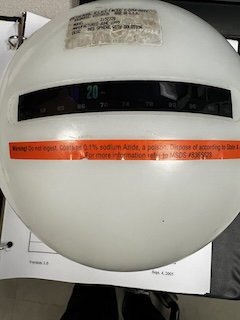

[Research Infrastructure](index.md) >

# QA

- [Overview](#overview)
- [Weekly metrics](#metrics)
- [Weekly QA reports](#weeklyQA)
- [Phantom](#phantom)

## Overview

[QA metrics](#weeklyQA) using the tools created by the Function
Biomedical Informatics Research Network (fBIRN) are generated on
[weekly basis](#weeklyQA) to monitor stability of the scanner. These
scans run a standardized fMRI protocol executed on an [agar
phantom](#phantom) using the DBIC's 32- and (since 2018) 64-channel
[head coils](coils.md). Details of the FBIRN protocol can be found on the [NITRC fBIRN project page](https://www.nitrc.org/projects/fbirn) and in the references
below. Longitudinal results of mean ghost percentage,
signal-to-fluctuation noise ratio (SFNR), and signal-to-noise ratio
(SNR) are updated here weekly. Abnormalities in any of the metrics may
indicate instability of some hardware component, and such
abnormalities are investigated. In addition, the Siemens customer QA
tool is run to check coil elements of the head coil (weekly) and body
coil (monthly) and as needed.

The acceptable mean ghost percentage threshold is less than 3% percent (ref 2). The first QA conducted on the [DBIC's Siemens Prisma MAGNETOM](fmri_scanner.md) was September 12, 2016.

## 32-channel headcoil

## 64-channel headcoil

## Weekly QA metrics

Below are definitions of the metrics found on the DBIC's weekly QA report. Definitions have been adopted from the original authors.

- Signal image - the mean signal across time
- Signal summary value - the mean across the ROI of the signal image
- Standard Deviation Image (Temporal Fluctuation Noise Image) - voxel by voxel residuals of second-order polynomial fit across
- SNR summary value - the signal summary value ('mean') divided by the standard deviation across the ROI of the static spatial noise image
- SFNR summary value - the mean across the ROI of the signal image divided by the temporal fluctuation image
- SNR Image
- SFNR Image
- Percent fluctuation - 100\*std/msi where 'std' is a summary value calculated as the standard deviation of the residuals of a second-0rder polynomial fit of the time series and 'msi' is mean signal intensity of the time-series.
- Drift - 100\*(maxroi-minroi)/msi where 'maxroi' and 'minroi' are the maximum and minimum values of the mean raw signal over the ROI.
- Driftfit - 100\*(maxfit-minfit)/msi where 'maxfit' and 'minfit' are the maximum and minimum values of the fit.
- Fourier Analysis (Magnitude Spectrum) - the frequency spectrum resulting from a Fourier analysis of the residual data.
- Radius of Decorrelation (RDC) - a measure of the size of ROI at which statistical independence of the voxels is lost.
- Smoothness (Full-width Half-maximum) - calculated using the AFNI tool 3dFWHMx
- Center of mass - a simple mean intensity of each volume, with each voxel's value weighted by its index in the X, Y, or Z direction.
- Odd-Even Difference Static Noise Image
- Mean Ghost Percentage - 100\*meanGhost/meanSignal. The ghost metrics are calculated for each volume by taking a dilated mask ("original mask") of the data, and shifting it by N/2 voxels in the appropriate axis to create a "ghost mask". The mean intensities of those voxels in the original mask and not in the ghost mask ("meanSignal") and of voxels in the ghost mask and not in the original mask ("meanGhost") are calculated.

References:

1. Friedman L, Glover, GH. Report on a multicenter fMRI quality assurance protocol. J Magn Reson Imaging. 2006a. 23(6): 827-839. [PubMed: 16649196]

2. Acceptance Testing and Quality Assurance Procedures for Magnetic Resonance Imaging Facilities, AAPM Report No. 100

3. [BXH/XCEDE tools (NITRC project page)](https://www.nitrc.org/projects/bxh_xcede_tools)

## Weekly QA reports

### [**2026**](qa_2026.md)

#### [**2025**](qa_2025.md)

#### [**2024**](qa_2024.md)

#### **[2023](qa_2023.md)**

#### [**2022**](qa_2022.md)

#### **[2021](qa_2021.md)**

#### **[2020](qa_2020.md)**

#### **[2019](qa_2019.md)**

#### **[2018](qa_2018.md)**

#### **[2017](qa_2017.md)**

#### **[2016](qa_2016.md)**

## Phantom

The DBIC collects its QA data using an agar phantom manufactured in 1999 by the General Electric Company, model number 2152220.

